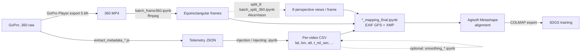

# Augmenting City Models with Handheld LiDAR and 3D Gaussian Splatting — 360° / 3DGS Data Preparation

[](https://doi.org/10.5194/isprs-archives-XLIX-B2-2026-1117-2026)
[](https://isprs-archives.copernicus.org/articles/XLIX-B2-2026/1117/2026/isprs-archives-XLIX-B2-2026-1117-2026.html)

Code accompanying the paper:

> Suwardhi, D., Andika, W., Widyastuti, R., Fadilah, W. A., Murtiyoso, A., Grusennmeyer, P., Remondino, F., and Helmy, F.: **Augmenting City Models with Handheld LiDAR and 3D Gaussian Splatting for Inclusive Pedestrian Infrastructure Assessment**, Int. Arch. Photogramm. Remote Sens. Spatial Inf. Sci., XLIX-B2-2026, 1117–1124, https://doi.org/10.5194/isprs-archives-XLIX-B2-2026-1117-2026, 2026.

## Scope

The paper combines handheld LiDAR, 3D Gaussian Splatting (3DGS) from 360° video, and the CityGML 3.0 Transportation model for pedestrian accessibility assessment.

**This repository contains the 360° video → 3DGS data-preparation branch of that workflow:**

1. Extracting GPS and orientation telemetry (GPMF) from GoPro `.360` recordings
2. Extracting frames from the exported 360° MP4 video
3. (Optional) Splitting each equirectangular frame into 8 perspective views
4. (Optional) Smoothing / constraining the GPS trajectory
5. Mapping telemetry to frames and writing it into EXIF/XMP (geotagging for alignment in Agisoft Metashape)
6. Mask helpers for 3DGS training


## Pipeline overview



Two camera models are supported:

| Variant | Images given to Metashape |
|---|---|
| `360/` | Full equirectangular frames |
| `split_8/` | 8 perspective crops per frame (AliceVision, from Meshroom) |

Each variant comes in two modes: `folder/` processes every video in a dataset folder in batch; `single_file/` processes one video and was used for testing.

## Repository structure

```
.
├── folder/                         # Batch processing (all videos in a folder)
│   ├── 360/
│   │   ├── extract_metadata_folder.js   # .360 → telemetry JSON (all files in inputDir)
│   │   ├── package.json                 # Node deps: gopro-telemetry, gpmf-extract
│   │   ├── batch_frame360.ipynb         # MP4 → equirectangular frames (ffmpeg)
│   │   ├── mapping/
│   │   │   ├── injection.ipynb          # telemetry JSON → per-video CSV
│   │   │   └── 360_mapping_final.ipynb  # CSV → frames, write EXIF/XMP
│   │   └── allign_photo/
│   │       └── copy_mask.ipynb          # copy one static mask per frame; mask renaming
│   └── split_8/
│       ├── batch_frame360.ipynb         # MP4 → equirectangular frames (ffmpeg)
│       ├── batch_split_360.ipynb        # equirectangular → 8 perspective views (AliceVision)
│       ├── batch_preprocess_frame.ipynb # frame extraction + split in one notebook
│       └── mapping/
│           ├── injecting.ipynb          # telemetry JSON → per-video CSV
│           ├── smoothing_savgol.ipynb   # slope constraint + Savitzky–Golay smoothing
│           ├── smoothing_kalman.ipynb   # straight-line trajectory fit in ECEF
│           └── mapping_final.ipynb      # CSV → split frames, write EXIF/XMP
├── single_file/                    # Same steps for a single video
│   ├── 360/
│   └── split_8/
├── change_mask_name.ipynb          # strip _mask / _masked suffix from mask files
└── Workflow Gaussian Splatting.odt # Step-by-step capture/processing notes (Indonesian)
```

## Requirements

### Software

| Tool | Used for | Notes |
|---|---|---|
| Python 3 + Jupyter | All `.ipynb` notebooks | <!-- TODO: Python version used --> |
| Node.js + npm | Telemetry extraction (`*.js`) | |
| [FFmpeg / ffprobe](https://ffmpeg.org/) | Frame extraction, GPMF stream copy | must be on `PATH` |
| [ExifTool](https://exiftool.org/) | Writing XMP tags | must be on `PATH` |
| GoPro Player | `.360` → MP4 export | export at 5.6K |
| [Meshroom 2021.1.0](https://www.fosshub.com/Meshroom.html) | `split_8` variant only: `aliceVision_utils_split360Images` | download the 2021.1.0 release; the executable is in `Meshroom-2021.1.0/aliceVision/bin/`. Add that folder to `PATH` or put the full path in the notebook |
| Agisoft Metashape | Image alignment using the geotags | <!-- TODO: version / edition --> |

### Python packages

```bash
pip install numpy pandas pillow piexif scipy pyproj matplotlib jupyter
```

### Node packages

Run once inside each folder that contains a `.js` extractor:

```bash
cd folder/360
npm install                 # installs gopro-telemetry ^1.2.11 and gpmf-extract ^0.3.2
```

`single_file/split_8/` has no `package.json`; install the same two packages there with `npm install gopro-telemetry gpmf-extract`.

## Dataset directory convention

The notebooks derive output folders from the input path, so the dataset must follow this layout. **Do not use whitespace in folder names; use `_`.**

```
D:/dataset/
└── <location>/                         # e.g. alun_alun_bandung
    └── <capture_date>/                 # e.g. 211025 (DDMMYY)
        ├── 1.360_raw/                  # raw GoPro files: .360, .LRV, .THM
        │   ├── GS014251.360
        │   ├── metadata/               # telemetry JSON   (step 1)
        │   ├── output/                 # per-video CSV    (step 4)
        │   └── output_physical/        # smoothed CSV     (step 5, optional)
        ├── 2.360_mp4/                  # GoPro Player exports (step 2)
        │   └── GS014251.mp4
        ├── 3.frame_360/
        │   └── 3/                      # <fps>
        │       ├── summary_txt_fps3.txt
        │       └── GS014251/
        │           └── GS014251_image_0001.jpg
        ├── 4.frame_360_split/          # split_8 only
        │   └── 3_1300/                 # <fps>_<split resolution>
        │       └── GS014251/
        │           └── GS014251_image_0001_0.jpg ... _7.jpg
        ├── 4.camera_360_geotag/        # 360 variant output (step 6)
        │   └── GS014251/
        │       ├── GS014251_mapping.csv
        │       └── GS014251_image_0001.jpg
        └── 5.camera_geotag/            # split_8 variant output (step 6)
            └── GS014251/
                ├── folder_0/           # all view-0 images
                ├── ...
                └── folder_7/
```

Video IDs (`GS014251`) must stay identical across `1.360_raw`, `2.360_mp4`, the frame folders and the CSV names; the mapping notebooks match frames to telemetry by this ID. Frame files must match `^GS\d+_image_\d+\.jpg$` (360) or `^GS\d+_image_\d+_\d+\.jpg$` (split_8).

## Workflow

Commands below use the `folder/` (batch) scripts. Paths in angle brackets refer to the layout above.

### 1. Extract telemetry from `.360`

Edit `inputDir` and `outputDir` in `folder/360/extract_metadata_folder.js`, then:

```bash
cd folder/360
node extract_metadata_folder.js
```

For each `.360` file, FFmpeg copies the video stream and the GPMF data stream (`-map 0:3`) into a temporary MP4, `gpmf-extract` + `gopro-telemetry` decode it, and the result is written to `metadata/<video_id>.json`. The temporary MP4 is deleted afterwards.

### 2. Export `.360` to MP4

In GoPro Player: *Open media* → select the `.360` file → *File → Export* → set the export settings below → *Next* → save to `2.360_mp4/` with the same base name as the `.360` file. Screenshots are in `Workflow Gaussian Splatting.odt`.

| Export setting | Value |
|---|---|
| Resolution | 5.6K (5376 × 2688) |
| Projection | Equirectangular |
| Codec | HEVC |
| Bitrate | near maximum |
| Direction Lock | on |
| Horizon Level | on |
| AntiShake | on |

### 3. Extract frames

Run `batch_frame360.ipynb`. It asks for:

- the `2.360_mp4` folder path
- the extraction FPS (e.g. `3`)

Output: `3.frame_360/<fps>/<video_id>/<video_id>_image_%04d.jpg`, plus `summary_txt_fps<fps>.txt` with the duration of each video. The summary file is required by the mapping step.

### 3b. Split into 8 views (`split_8` only)

Run `folder/split_8/batch_split_360.ipynb`. It asks for:

- the `3.frame_360/<fps>` folder path
- the number of splits (e.g. `8`)
- the split resolution (e.g. `1300`)

It calls `aliceVision_utils_split360Images` with `--equirectangularNbSplits` and `--equirectangularSplitResolution`. Output: `4.frame_360_split/<fps>_<resolution>/<video_id>/`.

`batch_preprocess_frame.ipynb` runs steps 3 and 3b in one notebook; its second cell holds a full path to the AliceVision executable that must be changed.

### 4. Telemetry JSON → CSV

Run `mapping/injection.ipynb` (360) or `mapping/injecting.ipynb` (split_8). Edit the call on the last line:

```python
process_folder(r"<...>/1.360_raw/metadata", r"<...>/1.360_raw/output")
```

Each JSON becomes `<video_id>.csv` with columns `lat, lon, alt, spd_3d, spd_2d, datetime, t_rel_sec, yaw, pitch, roll` (plus empty placeholder columns for gyro/accel/temp). Orientation samples are interpolated onto the GPS timeline.

### 5. Trajectory smoothing (optional, `split_8/mapping/`)

Handheld consumer GNSS can be noisy, especially in altitude. Two notebooks are provided:

- `smoothing_savgol.ipynb`, cell "rapihin": clamps the vertical change between consecutive points to a maximum slope (`SLOPE_MAX = 0.08`, i.e. 8 %), then applies a Savitzky–Golay filter (`ALT_WINDOW = 9`, `XY_WINDOW = 5`, `POLY_ORDER = 2`). Edit `INPUT_CSV_DIR` / `OUTPUT_CSV_DIR`.
- `smoothing_kalman.ipynb`: replaces the trajectory with a straight 3D line in ECEF between the mean of the first and last `N_ENDPOINT = 10` points. The first cell does this across several consecutive videos (one continuous straight segment), the second for a single video. Intended for straight walking segments only.

If you smooth, point `METADATA_ROOT` in the next step to the smoothed CSV folder.

### 6. Map telemetry to frames and write EXIF/XMP

Run `mapping/360_mapping_final.ipynb` (360) or `mapping/mapping_final.ipynb` (split_8). Edit the four paths at the top:

```python
FRAMES_DIR_ROOT = r"<...>/3.frame_360/3"               # 360
# FRAMES_DIR_ROOT = r"<...>/4.frame_360_split/3_1300"  # split_8
METADATA_ROOT   = r"<...>/1.360_raw/output"            # or output_physical
VIDEO_INFO_TXT  = r"<...>/3.frame_360/3/summary_txt_fps3.txt"
OUTPUT_ROOT     = r"<...>/4.camera_360_geotag"         # 360
# OUTPUT_ROOT   = r"<...>/5.camera_geotag"             # split_8
```

For each video, frames are spread uniformly over the video duration and the telemetry is linearly interpolated at those times. Each image receives:

- EXIF GPS latitude, longitude, altitude, and `GPSImgDirection`
- EXIF `DateTime` / `DateTimeOriginal` (where available)
- a JSON blob in EXIF `ImageDescription` with the orientation and speed values
- XMP pose tags written with ExifTool

In `split_8`, view *k* of a frame gets the frame's yaw plus *k* × 360°/*n*, and the images are finally moved into `folder_0 … folder_7` (one folder per view direction). `mapping_final.ipynb` has two cells: the first writes yaw only, the second writes yaw, pitch and roll.

### 7. Alignment in Agisoft Metashape

Import the geotagged images (for `split_8`, the `folder_k` subfolders), use the EXIF GPS as camera reference, align, then export.

> For the paper, the first cell of `mapping_final.ipynb` (yaw only) was used; pitch and roll from the GoPro telemetry were too noisy and were not injected. Latitude and longitude were used as camera reference in Metashape.

<!-- TODO: Metashape settings used in the paper (accuracy, key/tie point limits, reference accuracy, sensor type for the 360 variant). -->

Static masks (e.g. for the camera operator or mount) can be produced with `allign_photo/copy_mask.ipynb`, which copies one mask image to `<frame_name>.png` for every frame. Edit `input_folder`, `mask_path`, `output_folder`.

### 8. Export for 3DGS

Export the aligned cameras and sparse points from Metashape in **COLMAP** format and use that folder as the 3DGS training input.

### 9. Mask naming for 3DGS training

If masks exported for training carry a `_mask` / `_masked` suffix, run `change_mask_name.ipynb` (edit `folder_path`) so mask names match image names. It does not overwrite existing files.

## Paths to edit

All paths in the notebooks are hard-coded for the authors' machines. Before running, change:

| File | Variable(s) |
|---|---|
| `folder/360/extract_metadata_folder.js` | `inputDir`, `outputDir` |
| `single_file/360/extract_metadata_js.js` | input `.360` path, temporary `.mp4` path, output JSON name |
| `single_file/split_8/extract_big_data.js` | reads `metadata.mp4` from the working directory |
| `*/batch_frame360.ipynb`, `*/batch_split_360.ipynb` | interactive `input()` prompts, nothing to edit |
| `*/batch_preprocess_frame.ipynb` (cell 2) | full path to `aliceVision_utils_split360Images.exe` |
| `folder/*/mapping/injection*.ipynb` | `process_folder(...)` arguments on the last line |
| `folder/split_8/mapping/smoothing_savgol.ipynb` | `INPUT_CSV(_DIR)`, `OUTPUT_CSV(_DIR)`, plot paths in last cell |
| `folder/split_8/mapping/smoothing_kalman.ipynb` | `INPUT_DIR`, `OUTPUT_DIR`, `INPUT_CSV`, `OUTPUT_CSV` |
| `folder/*/mapping/*mapping_final.ipynb` | `FRAMES_DIR_ROOT`, `METADATA_ROOT`, `VIDEO_INFO_TXT`, `OUTPUT_ROOT` |
| `single_file/*/**/*mapping*.ipynb` | `frames_dir`, `output_dir`, **`video_duration`** (seconds, set manually) |
| `*/allign_photo/copy_mask.ipynb` | `input_folder`, `mask_path`, `output_folder`, `folder_path` |
| `change_mask_name.ipynb` | `folder_path` |

## Acknowledgements

Telemetry decoding uses [gopro-telemetry](https://github.com/JuanIrache/gopro-telemetry) and [gpmf-extract](https://github.com/JuanIrache/gpmf-extract). Frame splitting uses [AliceVision](https://github.com/alicevision/AliceVision).

<!-- TODO: funding / institutional acknowledgements as in the paper. -->

## Citation

```bibtex
@Article{isprs-archives-XLIX-B2-2026-1117-2026,
  AUTHOR  = {Suwardhi, D. and Andika, W. and Widyastuti, R. and Fadilah, W. A. and Murtiyoso, A. and Grusennmeyer, P. and Remondino, F. and Helmy, F.},
  TITLE   = {Augmenting City Models with Handheld LiDAR and 3D Gaussian Splatting for Inclusive Pedestrian Infrastructure Assessment},
  JOURNAL = {The International Archives of the Photogrammetry, Remote Sensing and Spatial Information Sciences},
  VOLUME  = {XLIX-B2-2026},
  YEAR    = {2026},
  PAGES   = {1117--1124},
  URL     = {https://isprs-archives.copernicus.org/articles/XLIX-B2-2026/1117/2026/},
  DOI     = {10.5194/isprs-archives-XLIX-B2-2026-1117-2026}
}
```

## License

<!-- TODO: choose a license (e.g. MIT or Apache-2.0). -->

The paper is distributed under the [Creative Commons Attribution 4.0 License](https://creativecommons.org/licenses/by/4.0/).
